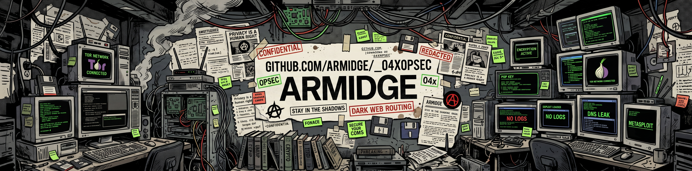

# _04xOPSEC

Repositório técnico e curado de recursos de OPSEC (*Operations Security*): ferramentas, referências e boas práticas para reduzir a exposição de informações pessoais e operacionais. Cada seção traz links (surface e/ou onion) com uma descrição curta e um comentário sobre uso, limitações e trade-offs.

### O que é OPSEC?

[OPSEC](https://csrc.nist.gov/glossary/term/operations_security) é o processo sistemático de identificar informações críticas, entender quem poderia explorá-las e aplicar contramedidas que neguem ao adversário o que ele precisa para agir contra você. Surgiu do [*Purple Dragon*](https://webarchive.library.unt.edu/web/20121021085736/http://www.nsa.gov/public_info/_files/cryptologic_histories/purple_dragon.pdf) (1966–67), estudo militar dos EUA para entender por que o inimigo parecia antecipar operações, e virou política nacional em 1988 ([NSDD 298](https://www.dcma.mil/News/Article/3258274/opsec-history-from-ancient-origins-to-modern-challenges/)), depois atualizada pela [NSPM-28](https://www.dcma.mil/News/Article/3258274/opsec-history-from-ancient-origins-to-modern-challenges/) em 2021.
 
O ciclo tem cinco etapas, repetidas sempre que o contexto muda: (1) identificar informações críticas, (2) analisar ameaças, (3) analisar vulnerabilidades, (4) avaliar riscos e (5) aplicar contramedidas. A diferença para a [segurança da informação clássica](https://www.cloudsek.com/knowledge-base/operational-security-opsec): ela protege o dado; a OPSEC protege o rastro em volta dele (hábitos, horários, metadados, padrões) que permite inferir o que você faz.

### 📚 Referências e leituras recomendadas:

-   [The Grugq's OPSEC Guide](https://grugq.github.io/)
-   [EFF Surveillance Self-Defense: Threat Modeling](https://ssd.eff.org/module/your-security-plan)
-   [Privacy Guides - Threat Modeling](https://www.privacyguides.org/en/threat-modeling/)
-   [Awesome OPSEC (GitHub)](https://github.com/RichardLitt/awesome-opsec)
-   [OPSEC & OSINT Tools (Airborne-Commando)](https://github.com/airborne-commando/OPSEC-OSINT-Tools)
-   [Livro OPSEC: Inteligência Cibernética na Prática](https://a.co/d/09CEkYwY)
-   [Livro Invisível na Rede: Dominando OPSEC e Identidade Digital com OSINT](https://a.co/d/0hhCeWlK)
-   [Dark Web OSINT Tools (Daniel Durnea)](https://github.com/danieldurnea/Dark-Web-Osint-Tools-)
-   [DeepDarkCTI (FastFire)](https://github.com/fastfire/deepdarkCTI)

## Navegadores (Foco em Privacidade)

-   [Brave Browser](https://brave.com/): Navegador baseado em Chromium com bloqueador de anúncios e rastreadores nativo. Mais seguro e privado *out-of-the-box* que o Chrome.
-   [Mullvad Browser](https://mullvad.net/pt/browser): Focado em combater *fingerprinting* e telemetria. Desenvolvido com o Tor Project para uso com VPN (sem rede Tor).
-   [LibreWolf](https://librewolf.net/): *Fork* do Firefox sem telemetria, com proteções antirrastreamento ativas por padrão e uBlock Origin embutido.
-   [Tor Browser](https://www.torproject.org/download/): Padrão obrigatório para roteamento anônimo e acesso à rede Onion.

Navegadores comerciais são desenhados para extrair dados. O uso de navegadores focados em privacidade bloqueia *scripts* hostis e requisições cruzadas. Ferramentas como Tor e Mullvad operam sob a lógica *Anti-Fingerprinting*: falsificam os dados do dispositivo para que ele pareça idêntico a milhares de outros, tornando a identificação única do usuário estatisticamente inviável.

## Extensões e Plug-ins (Antitracking e Segurança)

-   [uBlock Origin](https://ublockorigin.com/): Padrão ouro de bloqueio de conteúdo. Neutraliza redes de anúncios, malvertising e rastreadores de forma cirúrgica.
-   [Privacy Badger](https://privacybadger.org/): Bloqueia rastreadores invisíveis de terceiros com base em heurística durante a navegação.
-   [CanvasBlocker](https://github.com/kkapsner/CanvasBlocker): Impede o uso da API Canvas para gerar impressões digitais (*fingerprinting*) únicas do seu hardware.
-   [ClearURLs](https://docs.clearurls.xyz/): Remove parâmetros de rastreamento embutidos em URLs (ex: `?utm_source=...`).

Extensões como o uBlock Origin são essenciais para barrar a execução de rastreadores injetados na maioria dos sites. Limite-se estritamente ao necessário. O modelo de *Extension Fingerprinting* demonstra que quanto mais extensões exclusivas você instala, mais único e identificável seu navegador se torna.

## Buscadores alternativos (surface & onion)

-   [DuckDuckGo](https://duckduckgo.com/): Buscador focado em privacidade, sem rastreamento de histórico e resultados neutros.
-   [SearXNG](https://docs.searxng.org/): Metabuscador descentralizado que agrega resultados de mais de 70 serviços sem compartilhar seu IP ou histórico de busca.
-   [Ahmia](https://ahmia.fi/) (Clearnet/Onion): Mapeia serviços ocultos (*hidden services*) da rede Tor, com filtro contra material abusivo.
-   [Torch](http://xmh57jrknzkhv6y3ls3ubitzfqnkrwxhopf5aygthi7d6rplyvk3noyd.onion/) & [Tor66](http://tor66sewebgixwhcqfnp5inzp5x5uohhdy3kvtnyfxc2e5mxiuh34iid.onion/): Motores de busca não-censurados da rede Onion, vitais para acessar fóruns e índices obscuros.

Buscadores padrão (p. ex., Google) criam perfis comportamentais atrelados ao seu IP. Alternativas focadas em privacidade interrompem essa coleta. Utilizar motores da Dark Web (via Tor) garante acesso a domínios ocultos e isola o tráfego completamente do seu provedor de internet.

## OSINT e CTI (Cyber Threat Intelligence) na Dark Web

-   [deepdarkCTI](https://github.com/fastfire/deepdarkCTI): Indexa canais de ameaça no Telegram, sites de Ransomware, fóruns criminosos e bases de *exploits*.
-   [Katana](https://github.com/adnane-X-tebbaa/Katana) & [OnionSearch](https://github.com/megadose/OnionSearch): Automatizam a varredura e extração de resultados em múltiplos motores de busca Onion simultaneamente.
-   [OnionScan](https://github.com/s-rah/onionscan) & [TorBot](https://github.com/DedSecInside/TorBot): Auditores de domínios ocultos. Mapeiam falhas de configuração (como vazamentos Apache) que possam expor o IP real do servidor.
-   [ProtINTelligence](https://github.com/C3n7ral051nt4g3ncy/Prot1ntelligence): Focado em extrair pegadas digitais (*digital footprints*) e correlacionar usuários de ProtonMail.

Um bom OSINT frequentemente ajuda no processo de uma boa OPSEC. Auditar repositórios e usar ferramentas de varredura permite assumir a perspectiva de agentes maliciosos. Isso ajuda a mapear vazamentos próprios, avaliar vulnerabilidades de infraestrutura e garantir que identidades compartimentalizadas (*aliases*) permaneçam estanques.

## Verificação/exclusão de metadados

-   [ExifTool](https://exiftool.org/): Ferramenta de linha de comando para leitura, escrita e remoção de metainformações.
-   [MAT2](https://0xacab.org/jvoisin/mat2): Remove metadados de maneira forense em dezenas de formatos de arquivo.
-   [Dangerzone](https://dangerzone.rocks/): Converte PDFs e documentos suspeitos em arquivos seguros, executando-os em *sandbox* e extraindo apenas os pixels limpos para um novo documento.

Arquivos de mídia e documentos carregam metadados (geolocalização, dispositivo, software, horário) frequentemente usados para *doxing* ou análise forense. A sanitização desses dados é obrigatória antes de qualquer upload ou compartilhamento público.

## Melhores VPNs, DNSs & Proxyes // Camuflar IP

-   [Mullvad VPN](https://mullvad.net/): Foco em privacidade operacional, infraestrutura baseada em RAM e dispensabilidade de e-mail para cadastro.
-   [ProtonVPN](https://protonvpn.com/): Serviço suíço *no-logs* sob rigorosa jurisdição de privacidade.
-   [NextDNS](https://nextdns.io/) & [Quad9](https://quad9.net/): Resolução de DNS com foco em privacidade. NextDNS oferece filtros avançados; Quad9 bloqueia malwares com base em inteligência de ameaças.

Ocultar o endereço IP e criptografar o tráfego dificulta o rastreamento em nível de provedor (ISP). É crítico usar VPNs operadas em RAM e submetidas a auditorias independentes. O uso conjunto de um DNS seguro (DoH/DoT) impede o vazamento de requisições, ocultando os domínios acessados de sua operadora.

## Melhores Sistemas Operacionais

-   [Tails](https://tails.net/): Sistema *Live USB* amnésico (não salva dados em disco), forçando conexões exclusivas pela rede Tor.
-   [Qubes OS](https://www.qubes-os.org/): Sistema para OPSEC avançada, utilizando isolamento rigoroso por hipervisor (compartimentalização de aplicações).
-   [GrapheneOS](https://grapheneos.org/): SO mobile focado em privacidade, que substitui o Android comercial em aparelhos Pixel, removendo o Google Play Services.
-   [Whonix](https://www.whonix.org/): Arquitetura de isolamento baseada em duas máquinas virtuais (Gateway e Workstation), impedindo vazamentos de IP por malware.

Sistemas operacionais orientados à privacidade baseiam-se em *sandboxing* e amnesismo (descarte de sessão no reboot) para evitar coleta de telemetria e infecções. No mobile, sistemas como o GrapheneOS mitigam o rastreamento nativo devolvendo ao usuário o controle estrito sobre permissões e acessos de rede.

## Criptografia de Sistemas e Diretórios

-   [VeraCrypt](https://www.veracrypt.fr/): Padrão *open-source* para criptografia de disco e criação de contêineres ocultos.
-   [LUKS](https://gitlab.com/cryptsetup/cryptsetup): Criptografia nativa em bloco para Linux (Full Disk Encryption).
-   [Cryptomator](https://cryptomator.org/): Criptografia *client-side* que protege arquivos localmente antes de serem sincronizados em nuvens como Google Drive e Dropbox.
-   [Picocrypt](https://github.com/HACKERALERT/Picocrypt): Ferramenta de criptografia portátil, minimalista e de alta segurança.

A criptografia de dados em repouso (*Data at Rest*) impede o acesso físico não autorizado ou a mineração de dados por provedores de nuvem. Ferramentas como o VeraCrypt permitem "negação plausível" (*plausible deniability*), alocando volumes ocultos dentro de volumes visíveis para proteger o usuário sob coerção.

## Exclusão Segura e Sanitização de Dados

-   [BleachBit](https://www.bleachbit.org/): Padrão _open-source_ multiplataforma (Windows/Linux) para limpeza de rastros no sistema e sanitização (_wiping_) de espaço livre, impedindo a recuperação de arquivos deletados.
-   [Eraser](https://eraser.heidi.ie/): Utilitário avançado para Windows que destrói dados sensíveis sobrescrevendo-os múltiplas vezes utilizando padrões de segurança rigorosos (como DoD 5220.22-M ou Gutmann).
-   [SDelete](https://learn.microsoft.com/en-us/sysinternals/downloads/sdelete): Ferramenta oficial de linha de comando da Microsoft (Sysinternals) para destruição de arquivos individuais e sanitização de espaço livre em disco de forma rápida e segura.
-   [Extirpater](https://f-droid.org/pt_BR/packages/us.spotco.extirpater/): Aplicativo _open-source_ para Android disponível no F-Droid. Seu foco é preencher e sobrescrever o espaço livre do dispositivo, destruindo fragmentos de dados residuais.

A exclusão padrão (geralmente, mover para lixeira) dos sistemas operacionais remove apenas um ponteiro de alocação; **um dado bruto permanece intacto e recuperável por qualquer software forense**. Ferramentas de exclusão segura mitigam isso executando a sobrescrita múltipla (com zeros ou dados aleatórios) diretamente nos setores do disco, aniquilando fisicamente os resquícios da informação.

Em armazenamentos Flash (SSDs, pendrives e smartphones), recursos como _wear leveling_ e comandos _TRIM_ redirecionam gravações, **o que pode fazer com que a exclusão segura de arquivos individuais falhe**. Em dispositivos móveis modernos, que utilizam criptografia nativa (FBE/FDE), a tática mais segura e irrefutável para sanitização completa é a destruição da chave criptográfica por meio da redefinição de fábrica (_Factory Reset_ ou _Wipe Data_).

## Cofres/Gerenciadores de Senhas

-   [Proton Pass](https://proton.me/pt-br/pass): Open-source, com criptografia ponta a ponta (E2EE). Um diferencial tático é a geração integrada de aliases de e-mail (hide-my-email), permitindo o isolamento de identidades e mitigando a correlação de contas em vazamentos de dados.
-   [Bitwarden](https://bitwarden.com/): *Open-source* com criptografia *zero-knowledge* e sincronização segura em nuvem.
-   [KeePassXC](https://keepassxc.org/): Operado 100% offline, sem sincronização, garantindo soberania total sobre o cofre local.
-   [LessPass](https://lesspass.com/): Gerador *stateless*. Não armazena senhas; em vez disso, as gera *on the fly* combinando site, login e senha mestra matematicamente.

O reuso de senhas quebra qualquer postura de OPSEC. Gerenciadores eliminam essa falha permitindo credenciais únicas de alta entropia. Sob ameaças severas, soluções puramente offline (KeePass) ou *stateless* (LessPass) mitigam o risco de exposição global por quebras em servidores nas nuvens (*Supply Chain Attacks*).

## Autenticação de Dois Fatores (2FA)

-   [Aegis Authenticator](https://getaegis.app/): App TOTP *open-source* para Android, com suporte a backup local criptografado.
-   [Ente Auth](https://ente.io/auth/): Alternativa E2EE com backup seguro em nuvem e auditoria *open-source*.
-   [YubiKey](https://www.yubico.com/) & [Nitrokey](https://www.nitrokey.com/): Tokens físicos de hardware que oferecem autenticação irrefutável via protocolos FIDO2/WebAuthn.

A autenticação 2FA neutraliza ataques de *phishing* e o reuso de credenciais vazadas. Nesse sentido, o uso de chaves físicas U2F é o nível máximo de proteção, blindando contas até mesmo contra interceptação avançada de tokens temporários (*AitM*). Sobre autenticação via SMS, vale procurar por [*SIM Swapping*](https://clavis.com.br/blog/o-que-e-sim-swap/). 

## Mensageiros Seguros

-   [Signal](https://signal.org/): Referência técnica em criptografia E2EE, retendo o mínimo possível de metadados.
-   [Session](https://getsession.org/): Mensageiro descentralizado (*SIM-less*) que dispensa número de telefone no registro.
-   [Briar](https://briarproject.org/): Mensageiro P2P que sincroniza mensagens sem servidores centrais, operando via Tor, Bluetooth ou Wi-Fi.
-   [SimpleX Chat](https://simplex.chat/): Plataforma que descarta identificadores (números/nomes), utilizando URIs descartáveis para inviabilizar a formação de grafos sociais.

Mensageiros táticos combinam criptografia E2EE, Perfect Forward Secrecy e ausência de identificadores (como números de celular). Isso protege o conteúdo e frustra a análise de metadados, ocultando com quem, quando e onde as comunicações ocorrem.
